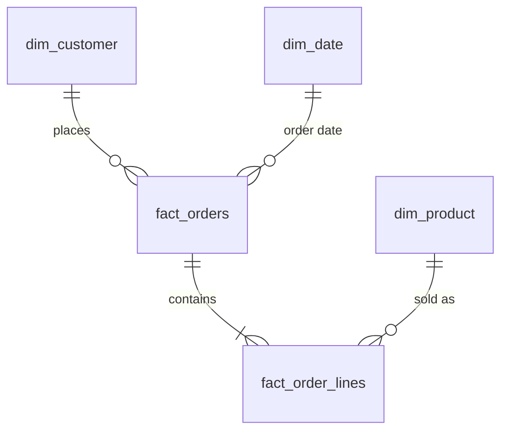

# SQL Practice: Retail Star Schema

A hands-on SQL practice repo for Analytics Engineer, BI and Data Analyst roles.
It has a small retail data warehouse (a star schema), **40 graded exercises**, and
tested solutions. Everything runs locally and for free with SQLite.

## What is inside

```
sql-practice/
├── practice.db                  # ready-to-use database (built from data/setup.sql)
├── data/setup.sql               # creates and fills every table (re-run to reset)
├── exercises/                   # your workspace: 5 files, 40 questions
├── solutions/                   # tested answers, no peeking until you have tried
├── notes/sql_patterns.md        # your personal cheat sheet of SQL patterns
└── README.md
```

| File | Topics | Questions |
|---|---|---|
| `01_select_filter_join` | filtering, sorting, joins, anti-joins | 8 |
| `02_aggregation_and_ctes` | GROUP BY, HAVING, CASE, CTEs, pivots | 8 |
| `03_window_functions` | RANK, ROW_NUMBER, LAG, running totals, NTILE | 9 |
| `04_dates_cohorts_retention` | dates, cohorts, repeat rate, retention | 7 |
| `05_cleaning_and_data_quality` | de-duplication, staging views, dbt-style tests, modelling | 8 |

Each question shows its difficulty, a hint, and the **expected row count and first row**, so
you can check your own answer before opening the solution.

## The data



| Table | Grain / purpose | Rows |
|---|---|---|
| `dim_customer` | one row per customer (city, segment, signup date) | 150 |
| `dim_product` | one row per product (category, price, cost in SEK) | 30 |
| `dim_date` | one row per day, 2024-2025 | 731 |
| `fact_orders` | one row per order (status, delivery days) | 700 |
| `fact_order_lines` | one row per product on an order (quantity, discount, revenue) | 1,381 |
| `sales_targets` | monthly revenue target per category, 2025 | 60 |
| `raw_customers` | deliberately messy staging data for cleaning exercises | 70 |

The data is synthetic. It includes realistic quirks on purpose: customers and products that
never appear on an order, cancelled and returned orders, duplicate and messy rows in
`raw_customers`, and a few order lines whose revenue does not add up.

## Quick start

**Option A: DB Browser for SQLite (easiest, free GUI)**
1. Install it from <https://sqlitebrowser.org>.
2. *File > Open Database* and choose `practice.db`.
3. Open the *Execute SQL* tab, then open an exercise file with the folder icon.
4. Write your answer under a question, select just that query, and press the Execute button.

**Option B: command line**
```bash
sqlite3 practice.db
.read exercises/01_select_filter_join.sql
```
Use `.headers on` and `.mode column` for readable output.

**Option C: VS Code**: install a SQLite extension (for example *SQLite Viewer* or *SQLTools*
with the SQLite driver) and open `practice.db`.

**Reset or rebuild the database at any time**
```bash
rm practice.db
sqlite3 practice.db < data/setup.sql
```
(In DB Browser: create a new empty database, then run `data/setup.sql` in the Execute SQL tab.)

## How to practice (the loop)

1. Read the question and hint. Try it **without** the hint first.
2. Write your query under the question and run it.
3. Compare the row count, columns and first row with the `Expected` lines.
4. There is often more than one right
   way. Rewrite your query a second way (for example, a subquery as a CTE).
5. If it does not match, debug it step by step: run each CTE on its own and check the joins.
6. Add the pattern to `notes/sql_patterns.md`, then commit your work (see below).

## From SQL Server to SQLite

You know T-SQL, so here are the main differences you will hit:

| SQL Server | SQLite (this repo) |
|---|---|
| `SELECT TOP 5 ...` | `... LIMIT 5` |
| `ISNULL(a, b)` | `COALESCE(a, b)` |
| `GETDATE()` | `date('now')` or `datetime('now')` |
| `DATEDIFF(day, a, b)` | `julianday(b) - julianday(a)` |
| `DATEADD(month, 1, d)` | `date(d, '+1 month')` |
| `FORMAT(d, 'yyyy-MM')` | `strftime('%Y-%m', d)` |
| `'a' + 'b'` | `'a' \|\| 'b'` |
| `LEN(x)` | `LENGTH(x)` |
| `CONVERT(varchar, x)` | `CAST(x AS TEXT)` |

Window functions, CTEs, `CASE`, `COALESCE` and joins work the same way.

## Progress tracker

- [ ] 01 Select, filter and join (0/8)
- [ ] 02 Aggregation and CTEs (0/8)
- [ ] 03 Window functions (0/9)
- [ ] 04 Dates, cohorts and retention (0/7)
- [ ] 05 Cleaning and data quality (0/8)

## Where this leads

Once you finish the exercises, this database is a good starting point for the portfolio project:
load the same tables into BigQuery, rebuild the staging and mart layers as **dbt** models (the
`stg_customers` view in exercise 05 is exactly a dbt staging model), turn the SQL tests into
dbt tests, and connect **Power BI** to the marts for a dashboard.
